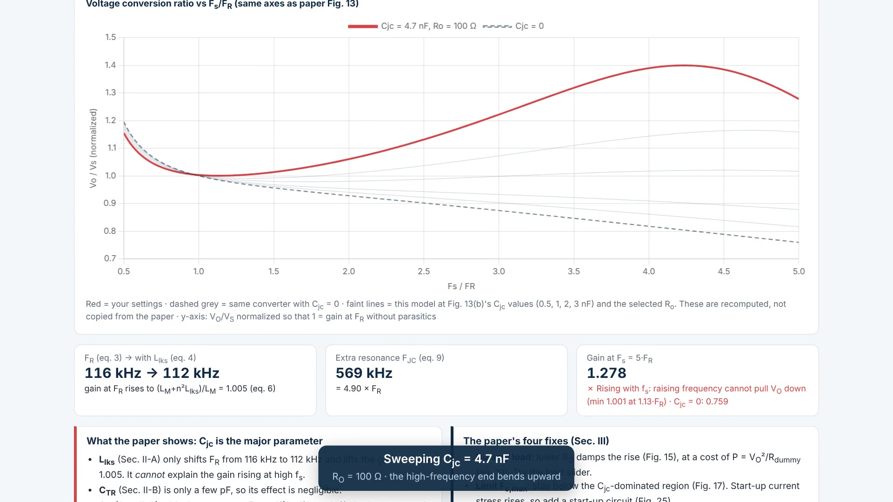

# How rectifier diode Cjc affects the LLC gain curve

An interactive explainer showing why an LLC resonant converter's gain can rise again at high switching frequency, so the output can no longer be regulated by raising frequency. The cause is the rectifier diode's junction capacitance (Cjc).

**▶ Live app:** https://warayutmachima007-hash.github.io/llc-cjc-gain-curve/

*Click the image to watch the 47-second walkthrough (`media/llc-cjc-demo.mp4`).*

## What it shows

- **The converter and its AC equivalent circuit.** Both drawings update live as you change Cjc and the load.
- **The gain curve vs Fs/FR.** You can sweep Cjc (0–5 nF) and the load (100 Ω – 10 kΩ).
- **One toggle per parasitic:** Llks, CTR and Cjc. Toggling them shows that **only Cjc** makes the gain rise with frequency.
- **Readouts from the paper's equations:** FR (eq. 3), the FR shift from Llks (eq. 4), the gain at FR (eq. 6) and the extra resonance FJC (eq. 9).
- **Load-step simulation:** a behavioural, averaged simulation with frequency control. Load steps from 100 Ω to a light load and back. With Cjc, the controller raises fs past the gain minimum, the gain rises instead of falling, and VO runs away while fs pins at its limit. This is the regulation failure the paper describes. (The controller, lag and limits are illustrative, not from the paper.)
- **The paper's four fixes:** dummy load, limiting Fs,max, rectifier type, and low-Q design.

## Source

B.-H. Lee, M.-Y. Kim, C.-E. Kim, K.-B. Park, G.-W. Moon, "Analysis of LLC Resonant Converter Considering Effects of Parasitic Components," *IEEE INTELEC 2009*, Incheon. [doi:10.1109/INTLEC.2009.5351740](https://doi.org/10.1109/INTLEC.2009.5351740)

The parameter values (Table 1, PDP column), equations and conclusions come from the paper. The circuit drawings, code and curves are an independent re-implementation, not reproductions of the paper's figures. The paper itself is not included in this repository.

**Reproduction note.** With these values, the model matches the paper's Fig. 13(b) within about ±0.04. To match, the plotted Cjc has to enter the model as Cjc·(NS/NP)², without the center-tap factor of 2 in eq. (12). The paper doesn't say which value its figures use. The app page gives the details.

## Tech

A single self-contained `index.html` with vanilla JS. [Chart.js](https://www.chartjs.org/) (MIT) is loaded from cdnjs, and there is no build step.

---

Personal project, views my own. Built with help from Claude.
